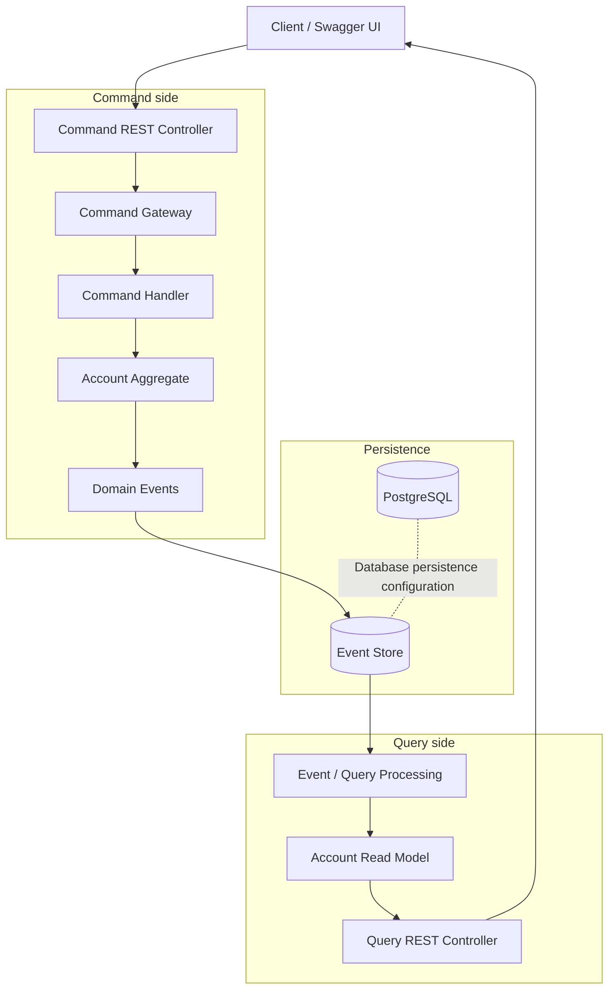
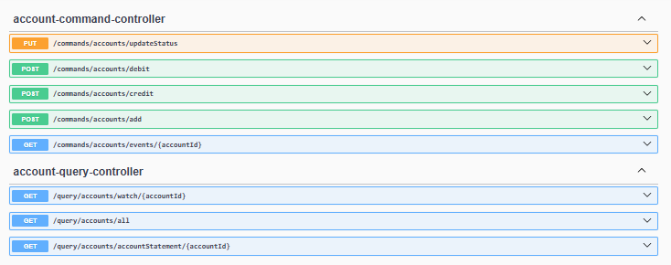
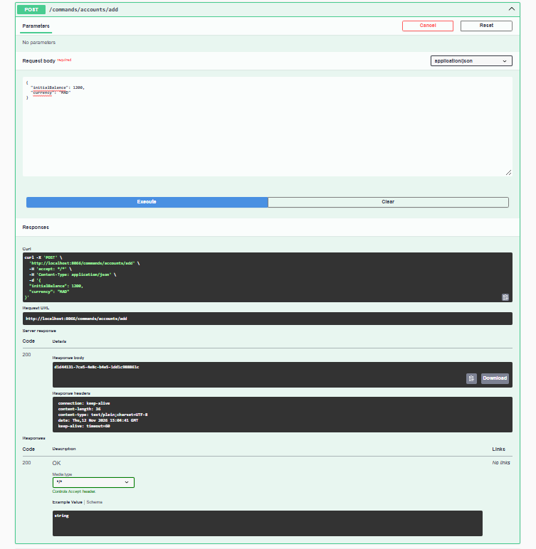
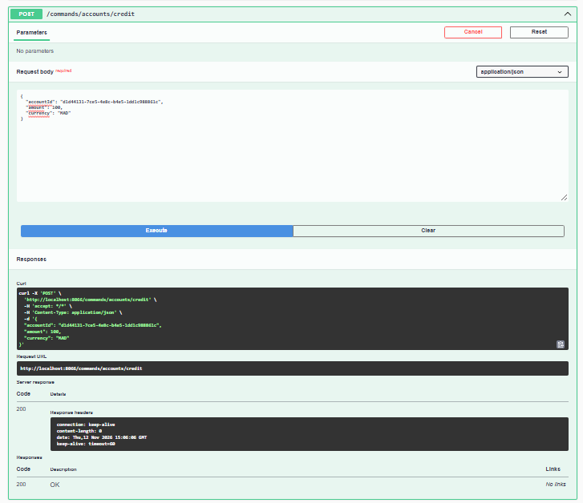
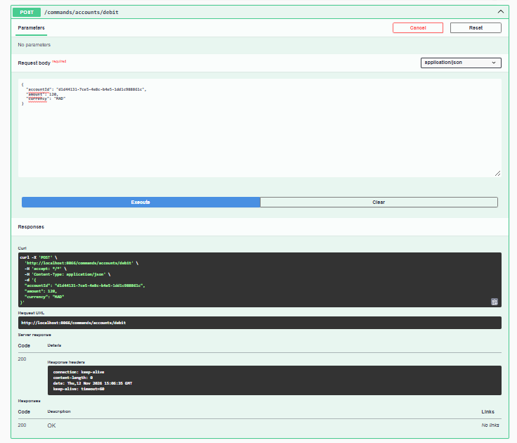
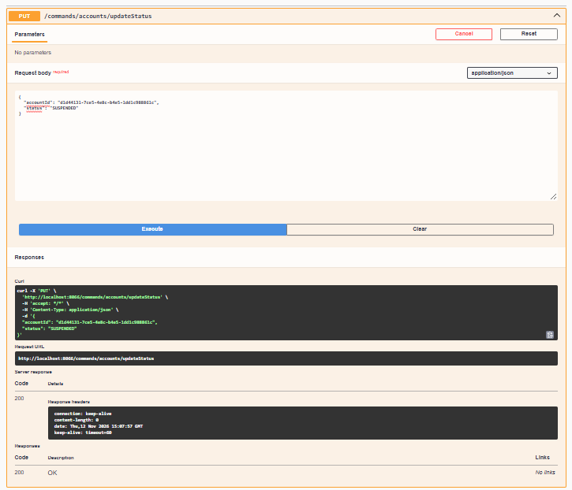
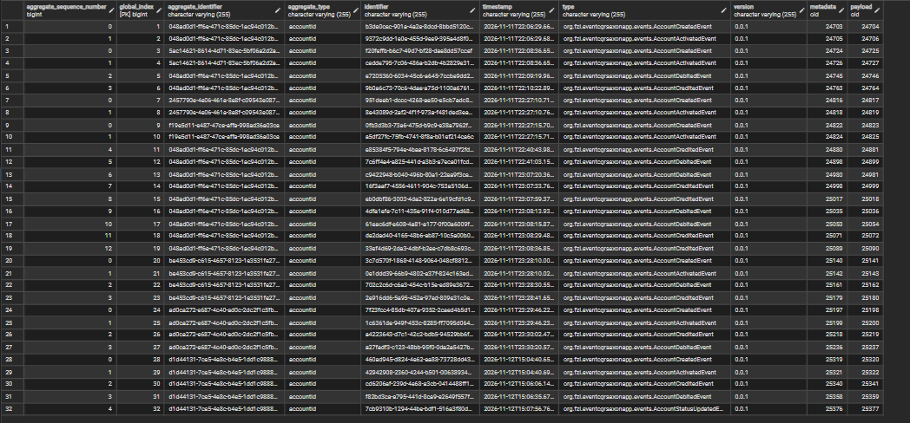
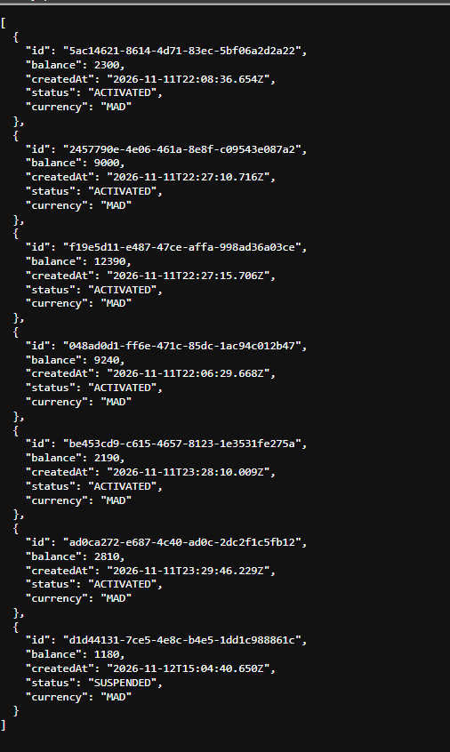
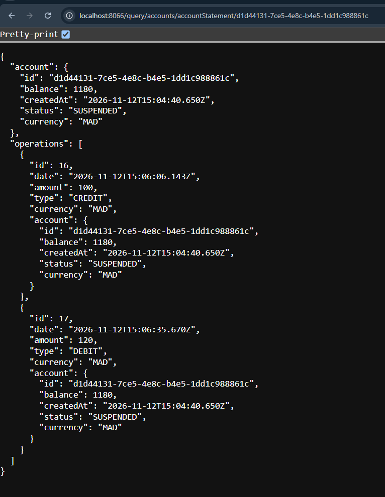

# Event Sourcing & CQRS with Spring Boot and Axon Framework

A Spring Boot application that demonstrates **Event Sourcing** and **CQRS (Command Query Responsibility Segregation)** through a bank account management use case.

The application exposes REST APIs to create bank accounts, credit and debit balances, change account status, retrieve the events associated with an account, and query account information and statements.

> **Project focus:** understanding how commands change application state, how events represent the history of those changes, and how queries read the resulting account data.

---

## Table of contents

- [1. Project overview](#1-project-overview)
- [2. Main concepts](#2-main-concepts)
- [3. Technology stack](#3-technology-stack)
- [4. Architecture](#4-architecture)
- [5. Application features](#5-application-features)
- [6. REST API](#6-rest-api)
- [7. Example requests](#7-example-requests)
- [8. Running the project](#8-running-the-project)
- [9. Testing with Swagger UI](#9-testing-with-swagger-ui)
- [10. Database and event persistence](#10-database-and-event-persistence)
- [11. Screenshots](#11-screenshots)
- [12. Project structure](#12-project-structure)
- [13. Important notes](#13-important-notes)

---

## 1. Project overview

Traditional applications often store only the latest state of an entity. For example, a bank account table may contain the current balance without keeping a complete, domain-level history of how that balance was obtained.

This project explores another approach: **Event Sourcing**.

Instead of treating the current account state as the only important information, the application represents changes as events. Account creation, credit operations, debit operations, and status changes can be represented as separate business events.

The project also applies **CQRS**, separating operations that modify the system from operations that retrieve information.

### Business use case

The application manages bank accounts and supports operations such as:

- Creating a new account with an initial balance and currency.
- Crediting an account.
- Debiting an account.
- Changing an account status, for example to `ACTIVATED` or `SUSPENDED`.
- Retrieving the event history associated with an account.
- Retrieving all accounts.
- Retrieving an account statement containing account information and its operations.

The examples and screenshots use Moroccan dirhams (`MAD`) as the account currency.

---

## 2. Main concepts

### 2.1. Event Sourcing

Event Sourcing is an architectural pattern in which changes to an entity are represented by a sequence of events.

Rather than considering only the latest account balance, the system can preserve the sequence of business events that led to the current state.

For example, an account may go through the following operations:

1. `AccountCreatedEvent` — the account is created with an initial balance.
2. `AccountActivatedEvent` — the account becomes active.
3. `AccountCreditedEvent` — an amount is added.
4. `AccountDebitedEvent` — an amount is withdrawn.
5. `AccountSuspendedEvent` — the account is suspended.

The exact event class names depend on the implementation; the names above describe the business meaning of the operations.

**How does it work?**

- A client sends a command requesting a business operation.
- The command is handled by the domain logic.
- If the operation is accepted, a corresponding event is produced.
- The event is persisted in the event store.
- Event handlers apply the event to the aggregate state.
- The current state can be reconstructed by replaying the events.

For an account, the balance can be understood as the result of applying its financial events in order.

For example:

```text
Initial balance: 2,000 MAD

Credit:          +500 MAD
Debit:           -200 MAD
Credit:          +100 MAD
-------------------------
Current balance: 2,400 MAD
```

This illustrates the idea of reconstructing state from events; it is an example, not a fixed dataset required by the application.

### 2.2. CQRS

CQRS stands for **Command Query Responsibility Segregation**.

It separates two responsibilities:

| Commands | Queries |
|---|---|
| Request a modification | Request information |
| Create an account | Retrieve all accounts |
| Credit an account | Retrieve an account statement |
| Debit an account | Retrieve account information |
| Change account status | Retrieve account events |

The command side handles operations that can change the domain state. The query side provides read operations without asking the client to perform a state-changing operation.

In this project, the separation is visible in the REST API through the `/commands` and `/query` URL prefixes.

### 2.3. Event Sourcing and CQRS together

These patterns solve related but different problems:

- **CQRS** separates the write model from the read model.
- **Event Sourcing** stores state changes as events instead of relying only on the latest state.

Together, they make it possible to maintain a history of business operations while exposing dedicated APIs for reading account information.

### 2.4. The role of Axon Framework

Axon Framework provides infrastructure for implementing CQRS and Event Sourcing in Java applications.

In an Axon-based architecture, the main building blocks commonly include:

- **Commands:** express an intention to perform an operation.
- **Command handlers:** process commands.
- **Aggregates:** protect business rules and manage domain state.
- **Events:** describe facts that have occurred.
- **Event handlers:** react to published events.
- **Queries and query handlers:** retrieve information for clients.
- **Event store:** persists events so that an aggregate's history can be recovered.

These concepts provide the foundation for understanding the command and query flows in this application.

---

## 3. Technology stack

| Technology | Role |
|---|---|
| Java 21 | Main programming language |
| Spring Boot 3.5.7 | Application framework and dependency management |
| Axon Framework 5.2.0 | CQRS and Event Sourcing infrastructure |
| Spring Web | REST API implementation |
| Spring Data JPA | Persistence integration |
| PostgreSQL 17 | Relational database service provided through Docker Compose |
| H2 Database | Runtime dependency available in the project |
| Springdoc OpenAPI | API documentation and Swagger UI |
| Maven | Dependency and build management |
| Docker Compose | Container orchestration for database services |
| Lombok | Reduces Java boilerplate code |

The main dependencies are declared in `pom.xml`. The PostgreSQL and pgAdmin services are defined in `compose.yaml`.

---

## 4. Architecture

### 4.1. High-level request flow

The following diagram illustrates the architectural flow at a conceptual level.



**Important:** this diagram explains the intended CQRS/Event Sourcing concepts. The exact persistence wiring and whether the read model is updated directly from events or through another mechanism must be confirmed against the application's configuration and Java handlers.

### 4.2. Command-side flow

A command represents an intention to change the state of an account.

For example, when a client requests a credit operation:

1. The client sends a `POST` request to the credit endpoint.
2. The command controller receives the request.
3. The command is dispatched to the command-processing component.
4. The domain logic checks whether the operation is valid.
5. An event representing the accepted operation is produced.
6. The event is stored and can be used to update the account state.

The same general process applies to account creation, debit operations, and status changes.

### 4.3. Query-side flow

The query side is responsible for retrieving account information.

Examples include:

- Listing all available accounts.
- Retrieving an account statement.
- Retrieving the events associated with a particular account.

The query API exposes these operations through endpoints beginning with `/query`.

---

## 5. Application features

### 5.1. Account creation

An account is created with an initial balance and a currency.

Example request:

```json
{
  "initialBalance": 2000,
  "currency": "MAD"
}
```

The API returns an account identifier that can be reused in subsequent operations.

The screenshots show account creation through Swagger UI and a successful HTTP response.

### 5.2. Account activation and suspension

The application exposes an endpoint for changing an account's status.

The screenshots demonstrate a status update to `SUSPENDED`.

This operation is important because account status can affect whether financial operations are allowed. The exact validation rules should be checked in the command handler or aggregate implementation.

### 5.3. Credit operation

A credit operation adds an amount to an account.

Example request:

```json
{
  "accountId": "YOUR_ACCOUNT_ID",
  "amount": 200,
  "currency": "MAD"
}
```

### 5.4. Debit operation

A debit operation requests the withdrawal of an amount from an account.

Example request:

```json
{
  "accountId": "YOUR_ACCOUNT_ID",
  "amount": 100,
  "currency": "MAD"
}
```

The application response and the account statement can then be used to inspect the resulting account information and operation history.

### 5.5. Account event history

The event retrieval endpoint allows a client to request the events associated with a particular account.

This is one of the most important demonstrations of Event Sourcing: instead of observing only the final account state, the client can inspect the operations that contributed to it.

### 5.6. Account statement

The account statement combines account information with its operations.

The demonstrated response contains:

- Account identifier.
- Current balance.
- Creation date.
- Account status.
- Currency.
- A list of operations.
- Operation identifier, date, amount, type, and currency.

The operation types visible in the screenshots include `CREDIT` and `DEBIT`.

---

## 6. REST API

The following endpoints are visible in the application's Swagger documentation and test screenshots.

### 6.1. Command endpoints

Base URL:

```text
http://localhost:8086
```

| Method | Endpoint | Description |
|---|---|---|
| POST | `/commands/accounts/add` | Create a bank account |
| POST | `/commands/accounts/credit` | Credit an account |
| POST | `/commands/accounts/debit` | Debit an account |
| PUT | `/commands/accounts/updateStatus` | Change an account's status |
| GET | `/commands/accounts/events/{accountId}` | Retrieve events for an account |

### 6.2. Query endpoints

| Method | Endpoint | Description |
|---|---|---|
| GET | `/query/accounts/all` | Retrieve all accounts |
| GET | `/query/accounts/accountStatement/{accountId}` | Retrieve an account statement |

### 6.3. Request field reference

| Field | Meaning |
|---|---|
| `accountId` | Identifier of the account |
| `initialBalance` | Initial balance supplied during account creation |
| `amount` | Amount involved in a credit or debit operation |
| `currency` | Currency of the account or operation |
| `status` | Requested account status |

Example account statuses visible in the application include `CREATED`, `ACTIVATED`, and `SUSPENDED`.

---

## 7. Example requests

Replace `YOUR_ACCOUNT_ID` with the identifier returned by the account creation request.

### Create an account

```bash
curl -X POST "http://localhost:8086/commands/accounts/add" \
  -H "Content-Type: application/json" \
  -H "Accept: */*" \
  -d '{
    "initialBalance": 2000,
    "currency": "MAD"
  }'
```

### Credit an account

```bash
curl -X POST "http://localhost:8086/commands/accounts/credit" \
  -H "Content-Type: application/json" \
  -d '{
    "accountId": "YOUR_ACCOUNT_ID",
    "amount": 200,
    "currency": "MAD"
  }'
```

### Debit an account

```bash
curl -X POST "http://localhost:8086/commands/accounts/debit" \
  -H "Content-Type: application/json" \
  -d '{
    "accountId": "YOUR_ACCOUNT_ID",
    "amount": 100,
    "currency": "MAD"
  }'
```

### Update account status

```bash
curl -X PUT "http://localhost:8086/commands/accounts/updateStatus" \
  -H "Content-Type: application/json" \
  -d '{
    "accountId": "YOUR_ACCOUNT_ID",
    "status": "SUSPENDED"
  }'
```

### Retrieve account events

```bash
curl -X GET \
  "http://localhost:8086/commands/accounts/events/YOUR_ACCOUNT_ID" \
  -H "Accept: */*"
```

### Retrieve all accounts

```bash
curl -X GET \
  "http://localhost:8086/query/accounts/all" \
  -H "Accept: application/json"
```

### Retrieve an account statement

```bash
curl -X GET \
  "http://localhost:8086/query/accounts/accountStatement/YOUR_ACCOUNT_ID" \
  -H "Accept: application/json"
```

> These examples follow the endpoint paths and request fields demonstrated in the screenshots. Check the generated Swagger schemas for any validation constraints or additional required fields.

---

## 8. Running the project

### 8.1. Prerequisites

Install the following tools:

- JDK 21
- Maven (or use the included Maven Wrapper)
- Docker Desktop with Docker Compose
- Git
- An IDE such as IntelliJ IDEA (recommended)

Verify your Java installation:

```bash
java -version
```

Verify Docker:

```bash
docker --version
docker compose version
```

### 8.2. Clone the repository

```bash
git clone https://github.com/FatimaZahraLasfar/Event-Sourcing-cqrs-spring-axon-app.git
```

Navigate to the project:

```bash
cd Event-Sourcing-cqrs-spring-axon-app
```

### 8.3. Start the database services

The repository contains a `compose.yaml` file defining PostgreSQL 17 and pgAdmin.

Start the services:

```bash
docker compose up -d
```

Check running containers:

```bash
docker compose ps
```

View PostgreSQL logs:

```bash
docker compose logs -f postgres
```

The Compose configuration exposes the following ports:

| Service | Port | Purpose |
|---|---:|---|
| PostgreSQL | 5432 | Database connection |
| pgAdmin | 8088 | Database administration web interface |

The configured database name is `es-accounts_db`.

The current Compose file includes development credentials. Change them before using the configuration outside a local development environment.

### 8.4. Build the application

On Windows:

```powershell
.\mvnw.cmd clean package
```

On Linux or macOS:

```bash
./mvnw clean package
```

### 8.5. Run the application

On Windows:

```powershell
.\mvnw.cmd spring-boot:run
```

On Linux or macOS:

```bash
./mvnw spring-boot:run
```

The API examples and screenshots use port `8086`. Confirm that the application's runtime configuration sets this port before starting it.

---

## 9. Testing with Swagger UI

Springdoc OpenAPI is included in the project to expose interactive API documentation.

Once the Spring Boot application is running, open:

```text
http://localhost:8086/swagger-ui/index.html
```

Swagger UI allows you to:

1. Explore the available REST endpoints.
2. Inspect request and response schemas.
3. Provide JSON request bodies.
4. Execute HTTP requests directly.
5. Inspect response codes and returned data.

### Suggested testing sequence

For a coherent demonstration, execute the operations in the following order:

1. **Create an account** using `/commands/accounts/add`.
2. Copy the returned account identifier.
3. **Retrieve the account events** using `/commands/accounts/events/{accountId}`.
4. **Activate the account**, if required by the application's business rules.
5. **Credit the account** using `/commands/accounts/credit`.
6. **Debit the account** using `/commands/accounts/debit`.
7. **Change the account status** using `/commands/accounts/updateStatus`.
8. Retrieve all accounts using `/query/accounts/all`.
9. Retrieve the account statement using `/query/accounts/accountStatement/{accountId}`.

Use an account ID returned by your own execution rather than copying an ID from an old screenshot.

---

## 10. Database and event persistence

### PostgreSQL

The `compose.yaml` file defines a PostgreSQL 17 container with:

- A database named `es-accounts_db`.
- A persistent Docker volume for database files.
- Port `5432` exposed to the host.
- A dedicated Docker network.

The file also defines a pgAdmin container, exposed on port `8088`, to facilitate database administration.

### pgAdmin

After starting Docker Compose, open:

```text
http://localhost:8088
```

Use the development credentials configured in `compose.yaml` to access pgAdmin. When registering the PostgreSQL server, use the appropriate hostname for the connection context:

- From another container on the Compose network: `postgres`
- From the host machine: `localhost`

### Event persistence

In an Event Sourcing application, the event store is responsible for preserving the sequence of events associated with aggregates.

This is different from simply saving the latest account balance in a relational table.

The screenshots demonstrate event retrieval and the account statement. The exact event-store implementation, database schema, and storage configuration should be verified in the application's Axon and datasource configuration.

---

## 11. Screenshots

The following screenshots are the most useful ones to include because each illustrates a specific part of the application.

Create this folder in the repository:

```text
docs/
└── images/
```

Copy the selected screenshots into that folder and rename them as indicated below.

### 11.1. Swagger API documentation

Shows the exposed REST API and the request schemas.



### 11.2. Account creation

Shows the request to create a bank account, including the initial balance and currency, and the successful response containing the account identifier.



### 11.3. Credit and debit operations

Shows the REST requests used to perform financial operations on an account.





### 11.4. Account status update

Shows how the account status is changed through the command API.



### 11.5. Account event history

Shows the events associated with an account, illustrating how the application's history can be inspected.



### 11.6. Querying all accounts

Shows the query endpoint returning account information, including account ID, balance, creation date, status, and currency.



### 11.7. Account statement

Shows the account information together with its credit and debit operations.



---

## 12. Project structure

The repository is a Maven-based Spring Boot application.

The visible root-level structure includes:

```text
Event-Sourcing-cqrs-spring-axon-app/
│
├── .mvn/
│   └── wrapper/
│
├── src/l
│   ├── main/
│   │   ├── java/
│   │   └── resources/
│   │
│   └── test/
│
├── compose.yaml
├── mvnw
├── mvnw.cmd
├── pom.xml
└── .gitignore
```

The Java application follows the command/query organization reflected by its REST API:

- Command-related components handle operations that modify account state.
- Aggregate and event-related components implement the domain behaviour.
- Query-related components expose account information and statements.

The exact package and class names should be read from the source tree in the IDE; the outline above intentionally avoids inventing filenames that are not confirmed here.

---

## 13. Important notes

- A successful HTTP response to a command does not necessarily mean that the endpoint should return a JSON representation of the updated account. The response type depends on the controller and command handling implementation.
- Event retrieval and account queries serve different purposes: the former exposes historical events, while the latter exposes account information.
- The current balance is a result of the account's accepted operations; it should not be confused with the event history itself.
- Account status and financial-operation validation should be enforced by the domain logic, not only by the Swagger interface.
- The PostgreSQL credentials in the development Compose configuration must not be reused in production.
- The presence of a PostgreSQL container does not, by itself, prove that every Axon event is stored in PostgreSQL. Verify the configured event store and datasource before describing the exact persistence mechanism.

---

## Author

**Fatima Zahra Lasfar**

GitHub: [@FatimaZahraLasfar](https://github.com/FatimaZahraLasfar)

Repository: [Event-Sourcing-cqrs-spring-axon-app](https://github.com/FatimaZahraLasfar/Event-Sourcing-cqrs-spring-axon-app)

---

## License

Add a license file to the repository if you intend to distribute the project under an open-source license.
